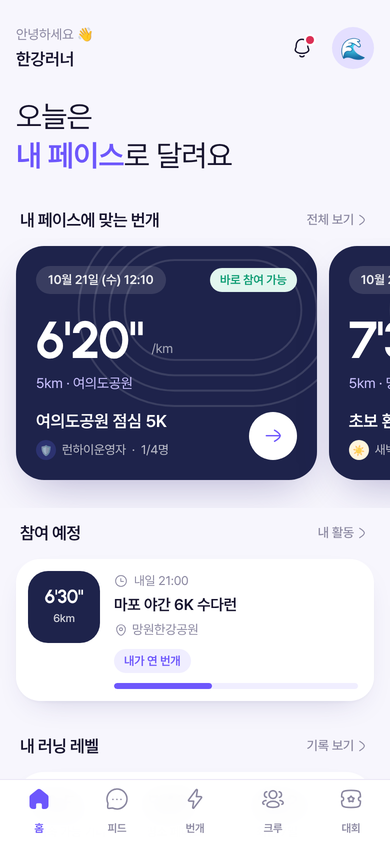
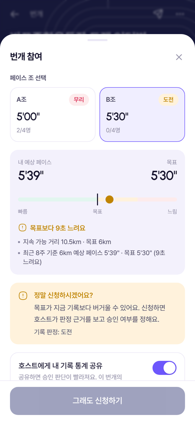
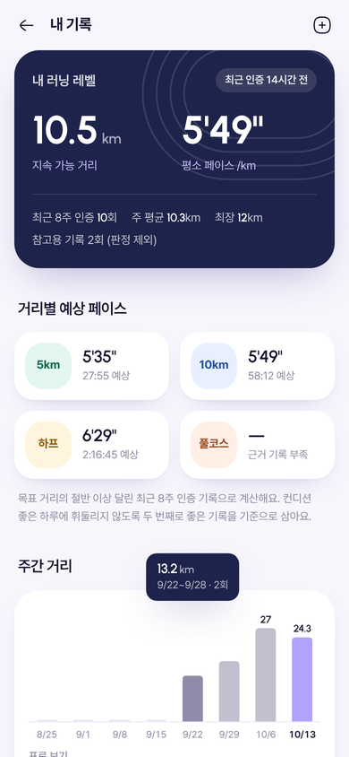
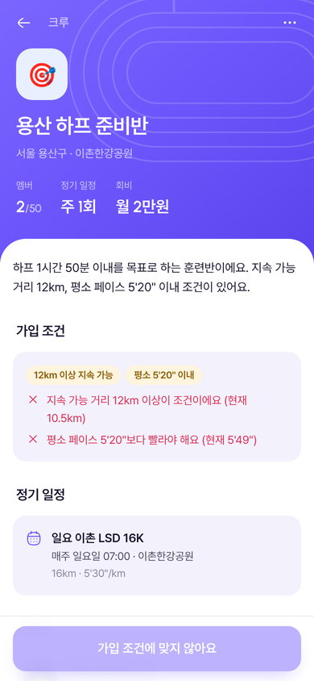

# 런하이 (Runhigh)

인증된 러닝 기록으로 **내 페이스에 맞는 러너와 믿고 함께 달리는** 러닝 커뮤니티입니다.
웹 앱과 Android 앱(같은 코드, Capacitor)으로 동작합니다.

<p>
  
  
  
  
</p>

## 바로 써 보기

| 방법 | 위치 | 비고 |
|---|---|---|
| Android 앱 | [최신 APK 내려받기](https://github.com/hahyeon01/run-high/releases/download/latest/runhigh-debug.apk) | `main`에 푸시할 때마다 GitHub Actions가 빌드해 `latest` 릴리스에 올려요 |
| 웹 데모 | `https://hahyeon01.github.io/run-high/` | 저장소 **Settings → Pages → Source를 ‘GitHub Actions’** 로 바꾸면 다음 푸시부터 배포돼요 |
| 내 컴퓨터 | `npm install && npm run dev` | http://localhost:5173 |

웹 데모와 APK는 기본이 **데모 모드**입니다. 서버 없이 기기(브라우저) 안 SQLite에 예시 데이터를 만들어 두고, 모든 기능이 그 안에서 동작해요.
데모 계정은 첫 화면의 ‘데모 계정으로 둘러보기’나 로그인 화면 목록에서 고를 수 있고, 비밀번호는 모두 `runhigh123!` 입니다.

| 계정 | 역할 |
|---|---|
| 한강러너 `demo@runhigh.app` | 기본 계정. 10km 5'50"대, 마포 새벽런 멤버, 번개 호스트 |
| 페이스메이커J `pacer@runhigh.app` | 상급 러너. 반포 번개 호스트(승인 처리 체험), 크루장 |
| 달리는다람쥐 `squirrel@runhigh.app` | 여성 전용 번개 호스트, 송파 크루장 |
| 초보러너민지 `minji@runhigh.app` | 입문 러너. 승인 대기 중인 신청이 있음 |
| 새벽런 `dawn@runhigh.app` | 마포 새벽런 크루장 (가입 승인·출석·회비 체험) |
| 청춘러너 `teen@runhigh.app` | 만 19세 미만. 청소년 허용 번개에만 참여 |
| 노쇼왕 `noshow@runhigh.app` | 노쇼 이력이 있는 계정 (신뢰 점수 차이 확인) |
| 런하이운영자 `admin@runhigh.app` | 운영 지표·신고 처리·대회 등록 |

## 무엇을 하나요

| 영역 | 기능 |
|---|---|
| **러닝 레벨** | GPS 측정, GPX·TCX 파일, 헬스 커넥트(Android)에서 가져온 **인증 기록**만으로 최근 8주 **지속 가능 거리**(2회 이상 소화한 거리)와 **평소 페이스**, 거리별 예상 페이스(Riegel)를 계산. 직접 입력한 최대 거리·페이스는 **참고용**으로만 표시 |
| **번개(그룹런)** | 호스트는 최근 14일 안 인증 기록이 있어야 열 수 있고, 열면 **호스트의 최신 기록 통계가 공개**됨. 페이스 조 여러 개, 성별·나이·청소년·신뢰 점수 조건 |
| **자격 판정** | 신청자 기록으로 ‘바로 참여 가능 / 도전 / 무리 / 기록 부족’을 판정. 바로 참여 가능하면 **승인 없이 확정**, 아니면 **예상 페이스·목표 비교 수치와 함께 “정말 신청하시겠어요?”** 를 보여 주고 호스트 승인으로 넘김 |
| **안전·신뢰** | 휴대폰 본인인증, 매너 서약, 출석·노쇼 기록, 매너 후기, **신뢰 점수**(출석률·노쇼·후기·신고 반영), 신고·차단, 지인에게 현재 위치 공유, 장소별 **단체 달리기 인원 규칙**(예: 반포종합운동장 그룹당 4명) |
| **크루** | 연령대를 강제로 고르지 않고 **크루장이 가입 조건**(나이·성별·지속 가능 거리·평소 페이스)을 정함. 가입은 **항상 운영진 승인**. 정기 일정 → 2주 치 일정 자동 생성, 참석 응답, 출석 체크, 공지, 회비 납부 관리 |
| **대회** | 내 러닝 지역(시·도)에 대회가 등록되면 알림, 관심 대회 **접수 오픈 알림(하루 전·10분 전·오픈 시각)**, 대회 달력, 목표 기록별 **페이스 메이트**와 **원정 동행** 모집. **배번(참가권) 거래 글은 차단** |
| **피드** | 하나의 전체 채널 대신 **지역·팔로잉·크루** 피드. 기록·사진·글 공유, 응원·댓글 |
| **운영** | 핵심 지표: **번개 성사율, 노쇼율, 4주 재참여율, 경고 후 신청자 완주율**. 신고 처리, 회원 정지, 대회 등록 |
| **개인정보** | 나이·성별·기록 통계·기록 목록 공개 범위 설정, 위치·운동 기록 동의, 만 14세 미만 가입 불가 |

자세한 규칙과 수치는 [docs/PRODUCT.md](docs/PRODUCT.md)에 있어요.

## 구조

```
packages/core   도메인 로직 + 서비스 계층 (서버·브라우저·Android 공용)
                레벨 산출, 자격 판정, 신뢰 점수, DB 스키마, RPC 메서드, 예약 작업, 데모 시드
apps/server     Fastify API 서버 (SQLite: better-sqlite3, JWT, 이미지 업로드, 1분 주기 예약 작업)
apps/web        React 웹 앱 + Capacitor Android 앱
                데모 모드: core를 브라우저 안 SQLite(sql.js)로 실행 / 서버 모드: HTTP로 API 호출
```

같은 서비스 코드가 서버(better-sqlite3)와 기기 안(sql.js)에서 그대로 돌아서, APK 하나로도 모든 흐름을 확인할 수 있습니다.
설계 설명은 [docs/ARCHITECTURE.md](docs/ARCHITECTURE.md), 디자인 기준은 [docs/DESIGN.md](docs/DESIGN.md)를 보세요.

**기술**: TypeScript · React 19 · Vite · Tailwind CSS 4 · TanStack Query · React Router 7 · zod · Fastify 5 · SQLite (better-sqlite3 / sql.js) · Capacitor 8 · Vitest · Playwright

## 개발

Node.js 22.12 이상이 필요해요.

```bash
npm install
npm run dev            # 웹 (데모 모드) http://localhost:5173
```

서버와 함께 띄우기:

```bash
cp apps/server/.env.example apps/server/.env
npm run dev:server     # API 서버 http://localhost:8787 (빈 DB면 데모 데이터 생성)
npm run dev:full       # 웹을 서버 모드로 (VITE_API_URL=http://localhost:8787)
```

검사:

```bash
npm run typecheck      # core · server · web 타입 검사
npm test               # 단위·통합 테스트 (core 54개, server 5개, web 4개)
npm run e2e            # Playwright E2E (데모 모드 빌드로 실제 사용자 흐름 16개)
```

## Android

```bash
npm run build -w @runhigh/web
cd apps/web && npx cap sync android
cd android && ./gradlew assembleDebug        # 또는 npx cap open android (Android Studio)
```

- 최소 Android 8.0 (API 26), JDK 21, Android SDK 36.
- 권한: 위치(GPS 측정 중에만), 알림(접수 오픈·번개 리마인더 예약 알림), 헬스 커넥트(러닝 운동·거리·경로만 읽기).
- `apps/web/android/app/debug.keystore`는 공용 디버그 키예요. CI가 만든 APK끼리 서명이 같아 덮어 설치가 됩니다. 출시용 서명은 `RUNHIGH_KEYSTORE`, `RUNHIGH_KEYSTORE_PASSWORD`, `RUNHIGH_KEY_ALIAS`, `RUNHIGH_KEY_PASSWORD` 환경 변수로 넣어 `assembleRelease` 하세요.
- 앱 안 **설정 → 연결**에서 서버 주소를 넣으면 서버 모드로 바뀝니다.

## 배포 (서버 + 웹 한 컨테이너)

```bash
docker build -t runhigh .
docker run -p 8787:8787 -v runhigh-data:/data \
  -e JWT_SECRET="$(openssl rand -hex 32)" -e DEMO_MODE=false \
  -e CORS_ORIGINS=https://your-domain.example runhigh
```

`/api/rpc/*` API와 서버 모드로 빌드한 웹 앱을 같은 출처에서 제공해요. DB와 업로드 사진은 `/data`에 저장됩니다.

## GitHub Actions

| 워크플로 | 하는 일 |
|---|---|
| `CI` | 타입 검사 → 단위·통합 테스트 → 빌드 → Playwright E2E |
| `Android APK` | 웹 빌드 → `cap sync` → `assembleDebug` → 아티팩트 + `latest` 릴리스에 APK 업로드 |
| `웹 데모 배포` | GitHub Pages가 켜져 있으면 데모 웹을 배포 (꺼져 있으면 건너뜀) |

## 아직 남은 일

- **휴대폰 인증 문자**: 문자 발송 업체 연동 전이라 데모 모드에서는 화면에 인증번호를 보여 줘요. 운영 전 `SmsSender` 구현이 필요해요.
- **대회 정보**: 들어 있는 대회는 데모용 예시예요(‘예시’ 표시). 실제 운영에서는 운영자가 공식 요강을 보고 등록해야 해요.
- **헬스 커넥트·백그라운드 GPS**: 실제 기기에서의 헬스 커넥트 연동은 아직 기기 테스트를 하지 못했어요. GPS 측정은 화면을 켜 둔 동안만 기록해요.
- **푸시 알림**: 접수 오픈·번개 리마인더는 기기 예약 알림(로컬 알림)으로 보내요. 서버 푸시(FCM)는 아직 없어요.
- **약관·개인정보 처리방침**: 앱에 들어 있는 문서는 법률 검토 전 초안이에요.

## 라이선스

MIT
